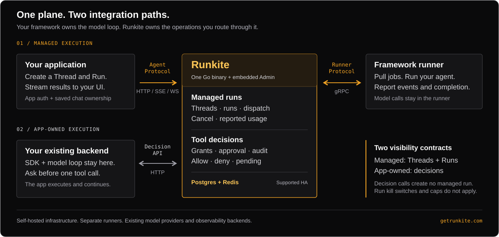
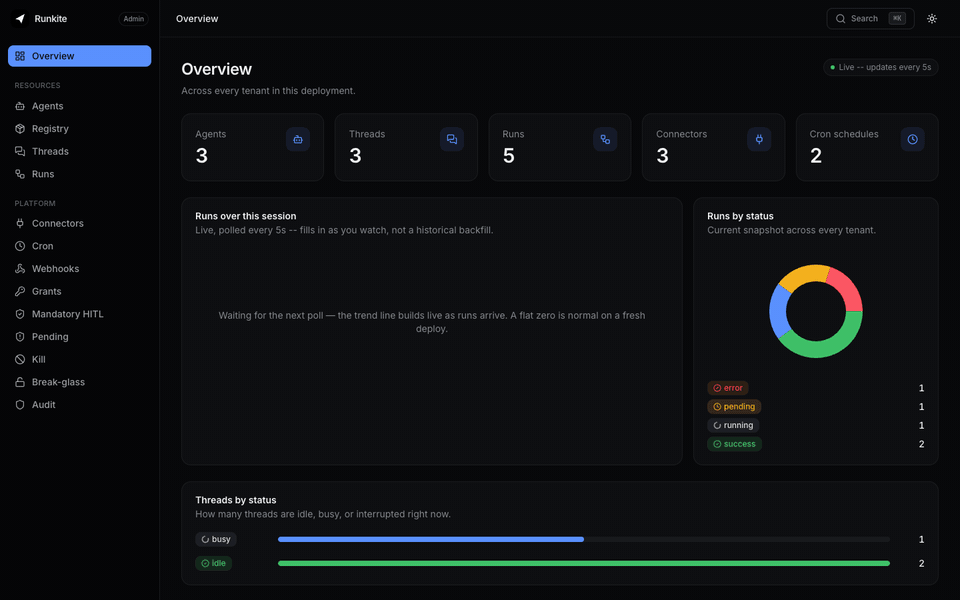

# Runkite

### Keep your agent framework. Share the control plane.

A self-hosted control plane for AI agents. Dispatch, connector access, human
approval, spend and audit in one Go binary, with an embedded Admin UI.

Run agents through Runkite, or keep the loop in your app and govern individual
tool calls. Your framework still owns the model loop.

Current source is Apache-2.0. Published v0.6.0 downloads retain BUSL-1.1.
See [license scope](#license).

**[Quick start](#quick-start)** · **[Choose your integration](#choose-an-integration-path)** · **[Documentation](https://getrunkite.com/support/)** · **[Try the sandbox](https://getrunkite.com/support/try.html)**

  

[Website](https://getrunkite.com/) · [Releases](https://github.com/getrunkite/runkite/releases) · [Examples](examples/) · [Architecture](#architecture) · [Development](#development) · [License](#license)

## Why Runkite

Each new agent brings the same operational questions: who can run it, which
connector it may call, which action needs approval, what it spent, and what
happened when a worker stopped. Runkite gives those operations a shared home
across frameworks.

| Need | What Runkite provides |
|---|---|
| **Run agents** | Authenticated dispatch, durable Threads/Runs, streaming, cooperative cancel and generation-fenced recovery through separate runners. |
| **Connect tools** | Run-bound connector sessions, secret resolution at session time, and credential injection on outgoing calls. |
| **Approve actions** | Connector grants, argument predicates and human approval before gated operations proceed. Tools must use the gate to acquire its policy. |
| **Track spend** | Reported usage, estimated USD, daily admission caps and optional reservations on SQL backends. See [accounting limits](docs/limitations.md). |
| **Operate together** | Embedded Admin, audit, agent delegation, Prometheus metrics and OTLP traces exported to your existing backend. |
| **Self-host** | One Go control-plane binary. Local SQLite/in-process mode for a first run; Postgres + Redis is the Supported HA profile. Framework runners keep their own Python or Node.js runtime. |

See [trust and governance](docs/trust-governance.md), [connectors](docs/connectors.md)
and the [backend support tiers](docs/architecture.md#backend-support-tiers) for
the enforcement and deployment contracts.

## Choose an integration path

| | Runkite owns execution | Your app owns execution |
|---|---|---|
| **Good fit** | Agents you want Runkite to dispatch and operate. | An existing Next, Nuxt or other backend that keeps its SDK loop. |
| **Entry point** | Agent Protocol over HTTP, SSE or WebSocket; Runner Protocol over gRPC. | `POST /governance/decide`, with approval status available for pending actions. |
| **Where the SDK runs** | In a separate Runkite runner. | In your application process. |
| **What Admin sees** | Managed Threads and Runs, outputs and reported usage. | Submitted policy decisions and pending actions on SQL backends. No managed Thread or Run is created. |
| **Controls** | Managed-run admission, cooperative cancel, usage accounting and recovery; connector policy where used. | Allow, deny or pending for the submitted tool call. Run kill switches, break-glass and spend caps do not apply. |

For managed chat, your app creates a Runkite run and consumes its stream. The
[shared AI SDK UI bridge](examples/managed_ai_sdk/README.md#use-the-same-frontend-with-a-python-runner)
keeps UI authentication, saved chat ownership, reconnect and explicit Stop in
your application.

For app-owned execution, [AI SDK tool helpers](examples/governance_ai_sdk/README.md)
and [Microsoft function middleware](examples/governance_agent_framework/README.md)
use the in-repository `runkite-governance` helpers. These helpers are not published
npm or PyPI packages. The app executes after allow and owns pending continuation.
A decision is not proof of execution, and its `run_id` is an operation correlation
value rather than execution idempotency.

### Bring your framework

The v0.6.0 runner packages include these profiles. Each supports its documented
subset of the framework's native features.

| Managed framework | Install or select | Runnable example |
|---|---|---|
| **LangGraph** | `pip install runkite-runner` | [Python echo agent](examples/echo_agent/) |
| **LangGraph.js** | `npm install -g runkite-runner` | [TypeScript echo agent](examples/echo_agent_ts/) |
| **Vercel AI SDK** | TypeScript runner with `--framework ai-sdk`; requires the `ai` peer | [Managed agent + UI bridge](examples/managed_ai_sdk/) |
| **Microsoft Agent Framework** | `pip install 'runkite-runner[agent-framework]'` | [Managed Microsoft agent](examples/managed_agent_framework/) |
| **OpenAI Agents SDK** | `pip install 'runkite-runner[openai-agents]'` | [Managed OpenAI agent](examples/managed_openai_agents/) |
| **Pydantic AI** | `pip install 'runkite-runner[pydantic-ai]'` | [Text and structured results](examples/managed_pydantic_ai/) |
| **Google ADK** | `pip install 'runkite-runner[google-adk]'` | [Managed ADK agent](examples/managed_google_adk/) |

CrewAI, LlamaIndex, AutoGen and plain LangChain adapters remain **checkout-only**.
Install their framework dependencies and follow [Runners](docs/runners.md).
The stock Python image keeps its LangGraph default and does not install the four
optional SDK extras. See the [profile contracts](docs/limitations.md) before
moving agents that use native workflows, approvals, handoffs or multimodal input.

## Quick start

Try the [public sandbox](https://getrunkite.com/support/try.html) with its shared
demo key, or run the local LangGraph example below. The sandbox uses fake agents;
you operate your own production plane.

From a checkout, with Go and Python installed:

~~~bash
git clone https://github.com/getrunkite/runkite
cd runkite
make build

# Terminal 1: local control plane, SQLite + in-process transport
./runkite dev --config examples/echo_agent/langgraph.json

# Terminal 2: Python runner
pip install runkite-runner
runkite-runner --config examples/echo_agent/langgraph.json \
  --grpc-address 127.0.0.1:50051 --http-address http://127.0.0.1:2026
~~~

Open Admin at **http://localhost:2026/admin/**.

[Full quickstart](docs/quickstart.md) · [Client requests and streaming](docs/client-sdk.md) · [Binary releases](https://github.com/getrunkite/runkite/releases) · [Docker and Helm](docs/deployment.md)

For a supported production deployment, use **Postgres + Redis**, client auth,
runner tokens and TLS. [Deployment](docs/deployment.md) and the
[operator runbook](docs/ops-runbook.md) describe setup and upgrades.

### See the real Admin

  

The Admin UI ships inside the control-plane binary. It needs no separate frontend
server. [Open the sandbox](https://getrunkite.com/support/try.html) or read the
[Admin guide](docs/admin.md).

## Architecture

Clients speak **Agent Protocol** to the plane. Workers pull assignments over
**Runner Protocol**, run their framework and report events and completion. Model
calls stay in those workers, using your provider or gateway.

The plane owns operational state and coordination. Postgres + Redis is the
Supported HA pair; optional backends have explicit
[support tiers](docs/architecture.md#backend-support-tiers).

<b>Follow one run through the HA profile</b>

~~~mermaid
sequenceDiagram
  autonumber
  participant C as Client / SDK
  participant LB as Load balancer
  participant CP as CP replica
  participant PG as Postgres
  participant RD as Redis
  participant R as Framework runner

  C->>LB: Create thread + run
  LB->>CP: Agent Protocol (HTTP)
  CP->>PG: Persist thread + run
  CP->>RD: Enqueue assignment
  R->>CP: GetJob (gRPC)
  CP->>RD: Claim assignment
  CP-->>R: RunAssignment + generation
  Note over R: Framework owns the model loop
  R->>CP: StreamEvents + ReportStatus
  CP->>PG: Commit output + checkpoint
  CP-->>C: SSE / WebSocket output
~~~

<b>Agent-to-agent delegation</b>

~~~mermaid
sequenceDiagram
  participant Coord as Coordinator agent
  participant CP as Control plane
  participant Work as Worker agent

  Note over Coord,CP: Parent run executes on a runner
  Coord->>CP: call_agent / callAgent
  CP->>CP: Check depth + parent/root bookkeeping
  CP->>Work: Dispatch child run
  Work-->>CP: Report child result
  CP-->>Coord: Return child output
~~~

[Architecture details](docs/architecture.md) · [Runner Protocol](runner-protocol/PROTOCOL.md) · [Agent delegation](docs/a2a.md) · [MCP server](docs/mcp-server.md) · [Integrations](docs/integrations.md)

## What Runkite is not

Runkite operates the infrastructure around an agent. Your framework keeps planning,
model calls and tool execution. Native tools that bypass connectors or decision
helpers do not automatically acquire Runkite policy. Managed cancellation is
cooperative and cannot undo completed side effects.

Model requests can go directly to your provider or existing gateway. Cost figures
are estimates based on reported usage and your pricebook, with the
[documented limits](docs/limitations.md). Self-hosting is the product; the public
demo is a sandbox.

## Documentation

| Topic | Links |
|---|---|
| **Start building** | [Quickstart](docs/quickstart.md) · [Client SDK](docs/client-sdk.md) · [Configuration](docs/configuration.md) · [Auth](docs/auth.md) |
| **Operate agents** | [Admin](docs/admin.md) · [Runners](docs/runners.md) · [Connectors](docs/connectors.md) · [Trust and governance](docs/trust-governance.md) |
| **Deploy and upgrade** | [Deployment](docs/deployment.md) · [Ops runbook](docs/ops-runbook.md) · [Limitations](docs/limitations.md) |
| **Understand the design** | [Architecture](docs/architecture.md) · [Engineering notes](docs/internal/architecture-deep-dive.md) · [Runner Protocol](runner-protocol/README.md) |

The [documentation site](https://getrunkite.com/support/) provides guided product
and integration walkthroughs. Additional reference: [API](docs/api.md),
[registry](docs/registry.md), [vectors](docs/vector-store.md) and
[fixture replay](docs/sim.md).

## Development

~~~bash
make test                 # SQLite + in-memory
make smoke-governance     # Governance checks on Postgres
make test-e2e             # Binary + runner end to end
~~~

[Contributing](CONTRIBUTING.md) includes the full development workflow.
[CI](https://github.com/getrunkite/runkite/actions/workflows/ci.yml) and the
[nightly framework matrix](https://github.com/getrunkite/runkite/actions/workflows/matrix.yml)
exercise separate validation scopes.

The [runtime hardening record](docs/internal/runtime-hardening.md),
[identity and atomic-result rationale](docs/internal/atomic-results-and-identities.md),
[HA recovery evidence](docs/internal/ha-recovery-validation.md) and
[upgrade guidance](docs/ops-runbook.md#hardening-upgrade) explain the v0.6.0
operational changes and their limits.

## License

[Apache License, Version 2.0](LICENSE). Copyright 2026 Sharan Harsoor.
See [NOTICE](NOTICE) for attribution.

This source tree permits commercial use, modification, redistribution and
hosting under Apache-2.0. Third-party components retain their own licenses;
the license does not grant general trademark rights. Runkite remains a
self-hosted product.

The change applies to source from the relicensing commit onward and future
releases. Already-published v0.6.0 and earlier artifacts retain their shipped
[BUSL-1.1 terms](https://github.com/getrunkite/runkite/blob/v0.6.0/LICENSE).
For the scope and release checks, see the
[license transition record](docs/internal/apache-2.0-transition.md).

## Contributing

See [CONTRIBUTING.md](CONTRIBUTING.md) to get started. Report security issues
privately following [SECURITY.md](SECURITY.md).
