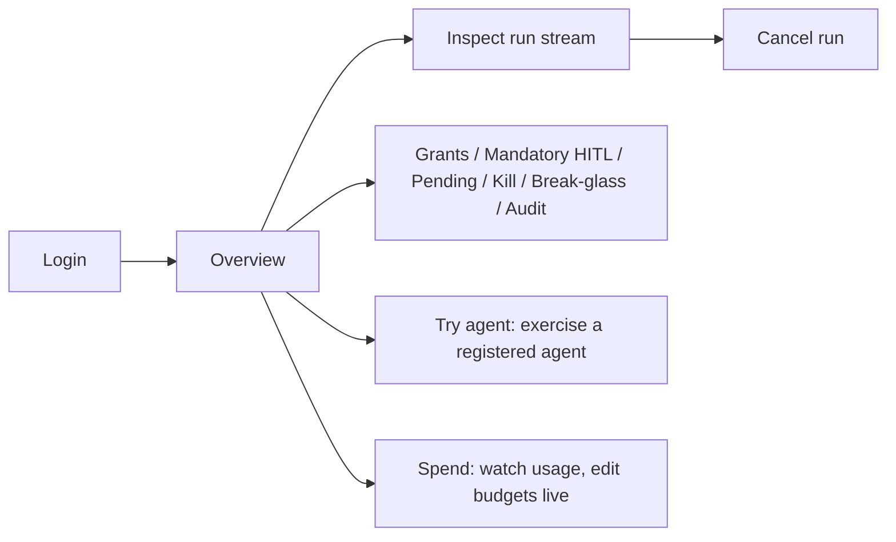

# Admin UI

> Deep dive moved from the root README. For a 60-second overview see the [root README](../README.md).


Admin is a React and TypeScript dashboard embedded into the `runkite` binary.
It needs no separate frontend deployment or Node.js runtime for end users. It
shows operational counts, registered agents, schemas and versions, registry
entries, managed threads/runs, connectors, schedules, webhook dead letters and a
Try agent client. SQL backends also provide durable grants, mandatory HITL,
pending decisions, kill/pause, break-glass, audit and estimated spend with live
FinOps overlays.

The walkthrough GIF shows an earlier navigation sequence. Try agent and Spend
are documented below, and Pending now includes app-owned in-process approvals
as well as connector approvals.

```
runkite serve --config langgraph.json
# -> Admin UI: http://localhost:2026/admin/
```

**Scope, stated plainly**: this is the *operational* half of "Admin API + UI" -- it does not include user/API-key management. There's no persisted user table today (`api_key` entries are static `langgraph.json` config, not a DB-backed model); building real user CRUD means building that persistence layer first, which is separate work, not a UI feature bolted onto the existing config.

**Auth**: the dashboard's login screen accepts whatever credential the configured `auth` provider expects (an API key or a JWT) and requires the `admin` permission specifically -- `read`/`write` are not enough, even for viewing the dashboard, since every `/admin-api/*` route sees across every tenant. Empty permissions follow the same `strict_permissions` rules as the rest of the API (fail-closed by default for `api_key`/`jwt`/`webhook`). Optional `auth.admin_keys` are also accepted on `/admin-api/*` only (see [Auth](auth.md)) and fail closed even with no primary provider configured. With **neither** `admin_keys` **nor** a primary `auth` provider configured at all (pure local/dev mode), the dashboard skips the login screen entirely -- there's no credential to log in with, and the API is fully open, same as the client-facing surface in that mode.

The static UI shell (`GET /admin/*`) is always public at the HTTP layer, same as any web app's frontend bundle -- it contains no data, and gating it would make the login page itself unreachable before a credential exists. The actual gate is the JSON API it calls once you sign in:

```
GET /admin-api/overview                     Summary counts (agents/threads/runs, by status) across every tenant -- real COUNT/GROUP BY aggregates, not a capped Search* sample
GET /admin-api/agents                       List agents (tenant_id visible; ?limit=&cursor= or ?offset=, default 50, max 200; X-Next-Cursor)
GET /admin-api/agents/{id}                  Agent detail
GET /admin-api/agents/{id}/schemas          Agent input/output/state/config schema
GET /admin-api/agents/{id}/versions         Agent version history (?tenant_id=; omitted merges every tenant's history)
GET /admin-api/registry                     List registry entries (tenant_id visible; ?limit=&cursor= or ?offset=; X-Next-Cursor)
GET /admin-api/registry/{name}              Registry entry detail (?tenant_id= disambiguates a cross-tenant name collision)
PUT /admin-api/registry/{name}              Publish/update an entry (?tenant_id=, default "default"); validates source_type/source_ref; audited
DELETE /admin-api/registry/{name}           Unpublish an entry (?tenant_id=); audited
GET /admin-api/registry/{name}/versions     Registry entry version history (same ?tenant_id=; omitted merges every tenant's history)
GET /admin-api/finops                       Effective FinOps config: file baseline, SQL overlay, and merged effective view
PUT /admin-api/finops                       Patch the FinOps overlay (pricebook/budgets/routing/reservation); validated server-side; hot-reloads this replica (siblings via 15s poll). 501 on non-SQL stores
DELETE /admin-api/finops                    Clear the overlay; file baseline becomes effective again
POST /admin-api/threads                     Try-agent: create a thread scoped to ?tenant_id= (reuses the client-facing handler under the Admin session)
POST /admin-api/threads/{id}/runs/stream    Try-agent: create + stream a run scoped to ?tenant_id= (same SSE wire format as the client-facing route)
GET /admin-api/threads                      List threads (tenant_id visible; ?status=; ?limit=&cursor= or ?offset=; X-Next-Cursor)
GET /admin-api/threads/{id}                 Thread detail
GET /admin-api/threads/{id}/runs            Runs on a thread (?limit=&cursor= or ?offset=; X-Next-Cursor)
GET /admin-api/runs                         List runs (tenant_id visible; ?status=/?agent_id=/?thread_id=; ?limit=&cursor= or ?offset=; X-Next-Cursor). UI shows a `sim` badge when `metadata.simulation` is set.
GET /admin-api/runs/{id}                    Run detail
GET /admin-api/runs/{id}/stream             Live/replayed SSE event log for a run (same mechanics as the client-facing stream)
GET /admin-api/audit-events                 Policy decisions (SQL: Postgres/MySQL/SQLite; ?tenant_id=&decision=&action=&run_id=&agent_id=&connector=&tool=&since=&until= RFC3339; ?limit=&cursor= or ?offset=; X-Next-Cursor). 501 on Mongo.
GET /admin-api/policy-grants                Durable connector grants (SQL; overlays langgraph.json defaults; ?tenant_id=&agent_id=&connector=; ?limit=&cursor= or ?offset=; X-Next-Cursor). 501 on Mongo.
POST /admin-api/policy-grants               Create/upsert a grant; hot-reloads this replica (siblings converge via 15s overlay poll)
GET /admin-api/policy-grants/{id}           Get one grant
PUT /admin-api/policy-grants/{id}           Replace a grant; hot-reloads this replica (siblings via poll)
DELETE /admin-api/policy-grants/{id}        Delete a grant; hot-reloads this replica (siblings via poll)
GET /admin-api/mandatory-hitl               Durable mandatory-HITL overlays (SQL; ?tenant_id=&agent_id=&connector=; X-Next-Cursor). 501 on Mongo.
POST /admin-api/mandatory-hitl              Create/upsert a rule; hot-reloads this replica (siblings via 15s overlay poll)
GET /admin-api/mandatory-hitl/{id}          Get one rule
PUT /admin-api/mandatory-hitl/{id}          Replace a rule; hot-reloads this replica (siblings via poll)
DELETE /admin-api/mandatory-hitl/{id}       Delete a rule; hot-reloads this replica (siblings via poll)
GET /admin-api/pending-actions              Connector and in-process tool approvals (SQL; ?tenant_id=&status=&run_id=&connector=; ?limit=&cursor= or ?offset=; X-Next-Cursor). 501 on Mongo.
GET /admin-api/pending-actions/{id}         Get one pending action
POST /admin-api/pending-actions/{id}/approve  Record approval (refuses hard deny or expired embedded row); caller continues the matching operation
POST /admin-api/pending-actions/{id}/deny   Mark denied
GET /admin-api/kill-switches                Tenant/agent kill or pause flags (SQL; ?tenant_id=&agent_id=; X-Next-Cursor). 501 on Mongo.
POST /admin-api/kill-switches               Upsert kill/pause; unless pause_only, cancel non-terminal runs in scope
GET /admin-api/kill-switches/{id}           Get one kill switch
DELETE /admin-api/kill-switches/{id}        Clear a kill switch (resume enqueue)
GET /admin-api/break-glass                  Time-bounded policy bypass windows (SQL; ?tenant_id=&agent_id=; X-Next-Cursor). 501 on Mongo.
POST /admin-api/break-glass                 Mint window (reason + expires_at required; max 24h; does not bypass kill/authz/limits)
GET /admin-api/break-glass/{id}             Get one window
DELETE /admin-api/break-glass/{id}          Revoke a window (policy Decide applies again)
GET /admin-api/connectors                   Connector status, including circuit breaker state
GET /admin-api/cron                         Cron schedules across every tenant
GET /admin-api/webhooks/dead-letters        Failed webhook deliveries
POST /admin-api/runs/{id}/cancel            Cancel a run (any tenant; reuses client handler under system context)
DELETE /admin-api/threads/{id}              Delete a thread (any tenant)
POST /admin-api/webhooks/dead-letters/{id}/redeliver  Re-POST a dead letter's stored payload (unsigned -- secret isn't persisted)
```

Building the UI from source (only needed if you're changing `admin-ui/` itself -- the built output is committed to `internal/adminui/dist/`, so `go build`/`docker build` never need Node.js):

```bash
cd admin-ui && npm ci && npm run build   # builds straight into internal/adminui/dist/
```

The unreleased hardening update confirms logout through the server, serializes
polls and aborts obsolete reads on navigation. Event readers preserve valid SSE
line endings and whitespace. Debug event panes show bounded previews with an
explicit truncation notice; durable output/API data is separate. IDs in Admin
paths are encoded, while new literal `.` and `..` run/thread IDs are rejected.
Manual dead-letter replay uses indexed ID lookup on built-in stores, including
records older than the latest 1,000. Replay refuses redirects, succeeds only on
2xx and remains unsigned. See [upgrade guidance](ops-runbook.md#hardening-upgrade-unreleased).

## Managed runs and in-process decisions

Threads, Runs and Try agent show executions Runkite creates and dispatches to a
runner. The optional managed AI SDK runner in this working tree uses these same
records after the app adopts the managed request path. It is unreleased until a
maintainer publishes a runner package/image containing it. Its initial scope is
text and local JSON-result tools, without native approval/resume or time travel.
See [Runners](runners.md) and the [integration guide](../site/support/sdk-integration.html).

An app that keeps its model loop calls `POST /governance/decide` for one tool
instead. That call creates no managed thread or run, even if its caller is an AI
SDK or Microsoft Agent Framework app. The caller's `run_id` is an operation
correlation ID and its `agent_id` need not be registered. Such IDs in Audit or
Pending do not imply that an Admin run/agent detail record exists.

Approval only changes the pending row. It does not resume a graph, invoke a
connector, or run the app's executor. A connector caller retries the same
argument-bound operation and consumes its one-shot capability. An embedded caller
checks `GET /governance/actions/{action_id}` and continues the exact stored
operation after `approved`, using app-owned idempotency. Embedded approvals still
pending after 24 hours expire; connector rows have no corresponding TTL.

Kill switches, break-glass and spend caps apply to their managed-run/connector
paths, not to standalone decisions. An allow or audit row proves a decision,
not execution. Spend is Estimated USD from metered managed runs, not a provider
invoice; cancellation can settle before trailing usage arrives. Cancellation
signals cooperative runner work and cannot undo an external side effect.

## Governance pages (SQL backends)

| Route | Purpose |
| --- | --- |
| `/admin/grants` | List / create / edit / delete durable `policy-grants` overlays (writer hot-reloads; other replicas poll ≤15s). Argument predicates are **not** this page — `policy.predicates` in `langgraph.json` (config-only). |
| `/admin/mandatory-hitl` | List / create / edit / delete durable mandatory-HITL overlays (same hot-reload / poll) |
| `/admin/pending` | Connector and in-process approvals. Connector retry consumes one matching capability; embedded callers poll and continue their exact stored app operation. Args shows the display map. |
| `/admin/kill` | Activate / clear tenant or tenant+agent kill or pause (drain pending/running unless pause-only) |
| `/admin/break-glass` | Mint / revoke time-bounded policy bypass (max 24h; kill/authz/limits still apply) |
| `/admin/audit` | Search policy decisions. Connector `tools/call` rows include an Args column (`attrs.args_digest` + capped `attrs.args`). |
| `/admin/spend` | Usage rollups, budget alerts, CSV/JSON export, and the live FinOps pricebook/budget overlay editor |

Mongo returns `501` on these APIs; the UI empty/error copy calls that out as a SQL requirement.

## Playground

| Route | Purpose |
| --- | --- |
| `/admin/try` | Built-in client: create a thread + stream a run against any registered agent. Shows live protocol events and per-turn usage. Not an agent builder; LLM/API keys are configured on the **runner** process, not in Admin. Which agents exist is defined by the control plane's `langgraph.json` **`graphs`** keys at boot (production: your agents only; `docker-compose.dev.yml` uses `examples/all_agents` for local demos). The dropdown can include stale rows if the DB outlived a config change — align CP + runner config and avoid multiple stray runners on the same queue. |

## Operator flow


