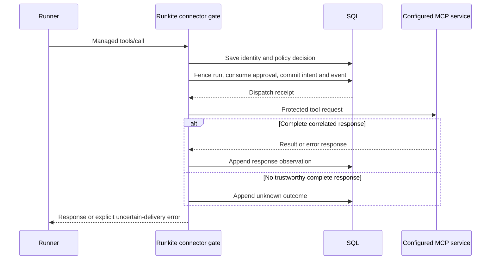

# Managed connector action evidence

Status: v0.7.0 candidate source (not published). This extends required policy audit with
opt-in evidence for managed MCP `tools/call` attempts. Released v0.6.1 binaries
do not implement these settings or Admin routes. See the
[operator manual](../../site/support/connector-actions.html) and
[upgrade procedure](../ops-runbook.md#connector-action-evidence-upgrade).

## The question a decision row cannot answer

A policy allow tells us which decision the plane made. It does not tell us
whether the tool was sent, whether a response arrived, or whether a payment,
message or database update took effect. A timeout after dispatch is particularly
dangerous: repeating an uncertain write can duplicate the effect.

We reuse the existing connector gate, argument digest, pending approval and SQL
transaction helpers. We do not add a second policy engine, credential database,
agent runtime or general workflow service. Each valid managed tool request gets
a server-generated action UUID. It is an attempt identity, not an execution
idempotency key. A second request, including an approval retry, gets a new UUID.
The existing approval ID remains a separate one-shot capability, bound to the
original managed run incarnation as well as its generation and exact arguments.

## Data and authority

`internal/models/connector_action.go` defines a typed action summary and ordered,
append-only event snapshots. SQL stores implement the optional
`state.ProtectedActionStore` in `internal/state/connector_action.go` through
`internal/state/sqlcompletion/connector_action.go`. Mongo does not implement it.
The two new tables are `connector_actions` and `connector_action_events`.

The plane captures tenant, principal, agent/version, run, original generation,
connector/tool, transport and argument digest. Run provenance comes from the
locked SQL run, not a caller's proposed version or timestamp. A separate immutable
run incarnation distinguishes retained evidence from a newly created run with
the same ID, including when timestamps are equal. Admin must verify that
incarnation before linking to or displaying a current run's evidence.

Postgres generates the identity with the run's database default. SQLite uses an
insertion trigger because its `ALTER TABLE ADD COLUMN` cannot add an expression
default. MySQL generates a fresh UUID in the shared run insertion function and
persists it as a literal in the same transaction, including admitted and cached
creation. This avoids nondeterministic SQL UUID expressions under statement-based
replication. Caller-supplied identities are not accepted as new run provenance.

Managed approval authority carries the same incarnation. New review requests do
not deduplicate against an unbound historical request or a previous run's request.
The migration deliberately does not infer approval authority from whichever run
exists at upgrade time. Old managed approvals require fresh review. Embedded
decision API approvals retain their separate namespace and do not acquire a run.

Policy effect and final authorization are distinct. An original `pending` can
later use `approved_capability`; an audited break-glass exception records its
window ID. Recording a decision does not consume an approval. The later
[target-bound approval milestone](target-bound-approvals.md) now fills the
configured target revision and matches it during approval consumption, including
when capture is off. Subsequent unreleased work now records configured policy,
optional observed tool-contract identity and registered credential provenance.
See [approval authority](approval-authority-and-quorum.md) and
[credential lifecycle](credential-lifecycle.md). No target or schema digest
attests remote implementation or its business effect.

New records exclude raw arguments, response bodies, raw JSON-RPC request IDs,
endpoint URLs, resolved credentials and arbitrary provider error text. Identifiers,
principal, argument digests and trace IDs can still be sensitive metadata. Protect
DB access and backups accordingly. Existing policy audit retains its separately
capped, redacted argument display; this is not a change to that retention policy.

## Why a timestamp and run ID were insufficient

Runs can be deleted and IDs reused. SQLite also stores the existing run display
timestamp with second precision, and callers can supply identical timestamps.
A generation and timestamp are therefore not a unique run instance. The schema
adds an opaque persisted incarnation: PostgreSQL generates it by default, SQLite
backfills old rows and uses an insert trigger, and MySQL inserts a fresh Go UUID
through its shared normal/admitted/cached run-creation function. Existing MySQL
rows receive literal UUIDs in bounded migration batches. A UUID() expression
default was rejected during live MySQL qualification because of replication
safety rules; changing operator binlog settings was not an acceptable fix.

Pending approvals cannot simply cascade from runs: standalone decisions use
app-owned operation IDs without any managed run. Managed approval rows instead
carry their run incarnation in a separate namespace. Deduplication, approval
validation and consumption must preserve that distinction. Historical unbound
managed rows cannot safely be attributed after ID reuse and require fresh
submission and review. Embedded decision approvals keep their existing expiry
and application-owned continuation contract. Do not backfill old approvals from
whichever run happens to have their ID at upgrade time.

## Commit intent immediately before the protected call

`internal/api/connector_action.go` creates the action, records the original policy
decision and supplies a synchronous connector callback. In JSON mode it runs
immediately before the tool HTTP request. In streamable HTTP it runs after
protocol initialization and discovery, immediately before `CallTool`.
Initialization, discovery and credential preparation can therefore contact an
upstream even when the protected call is later refused.

The callback rechecks the shared in-flight assignment. SQL prepare then locks
the stored run/thread, the action and any approval, in that order. It checks the
stored generation, active run and incarnation. The target-bound extension also
matches the action's configured target revision to its approval. Consuming a matching approval,
updating the action to `dispatch_intent`, and appending its event commit together.
A rolled-back transaction leaves approval authority unconsumed and sends no
protected tool request. A lost commit acknowledgement can instead leave durable
intent and consumed approval even though the callback refuses to send. Inspect
both records before a new attempt; an error alone does not prove rollback.
No SQL lock is held across a policy webhook, secret lookup or MCP
network call. MySQL uses READ COMMITTED for action transactions so a waiter can
see the mutation receipt that committed while it waited for the run lock.

This is still not a distributed transaction with Redis and the external service.
Cancellation can race the final network send. A committed intent proves that
Runkite authorized an attempt; it cannot prove bytes left the process, or that
the target committed an effect. We deliberately do not label intent as execution.

## Observe without inventing success

`internal/connector/action_observation.go` keeps fixed, bounded response metadata
separate from provider bodies. A complete correlated JSON-RPC response can become
`response_observed`, including a JSON-RPC error or MCP tool error. HTTP status is
an observation, not business success. Unverified, malformed, mismatched,
truncated or oversized responses and transport failures after intent remain
`outcome_unknown`. Negotiated SDK errors can normalize away wire details, so the
recorder is conservative when it cannot establish a complete observation.

Final persistence uses a detached, five-second context and at most two writes of
the same mutation. Mutation identity and digest make that persistence retry
idempotent. They never retry the tool. A late response from the original dispatch
receipt can be recorded after cancellation, reconciliation or reclaim. It stays
on the original generation; it cannot become the replacement attempt's result.
If final persistence fails, the caller receives an incomplete-evidence error
stating that the tool may have executed.

`cmd/connector_action_sweep.go` changes expired intents to unknown, at most 200
per tick with a 15-second bound and a 30-second interval. Its observer is
`runkite_reconciler`, not the connector. This is metadata reconciliation only.
It runs for existing SQL records even if new capture has been disabled.

## Retention and readers

Actions do not reference runs with cascading deletion. Run/thread pruning must
not erase the operation trail. Standalone Admin history therefore remains useful
after its run is gone. `run_available` and the client-side incarnation check
prevent a historical action from navigating to an unrelated reused run ID.

`retention.connector_actions_max_age` is disabled by default. When enabled, it
prunes only old `blocked`, `not_dispatched` and `response_observed` records, with
their events, in bounded batches. It preserves received/ready/pending attempts,
unresolved intents and unknown outcomes. An earlier pending attempt can remain
`approval_required` even after another attempt consumes or denies its linked
approval. That conservative history is retained, not silently reclassified.
Retention can thus grow despite a configured age; operators need backup/archive
and capacity planning. There is no automatic unknown-outcome resolution or
archive API in this milestone.

Admin is still globally privileged. Tenant/run filters select records, not
reviewer permissions. Lists use stable created-time plus UUID cursors and bounded
pages. Detail returns at most 200 events and explicitly marks truncation. The UI
uses bounded, serialized reads and offers manual refresh after polling stops.

## Correlation and boundaries

The response header `X-Runkite-Connector-Action-Id`, policy audit attribute
`connector_action_id`, policy trace attribute `connector.action.id`, and existing
SIEM policy events carry the same identity. They correlate a decision with SQL
history. Those correlation channels alone are not reliable lifecycle export.
Current source separately offers an opt-in
[durable action-event outbox](action-delivery-outbox.md): event and delivery
creation commit in the same SQL transaction, and HTTP delivery uses stable IDs
with at-least-once retry. Receivers must deduplicate; retrying evidence never
replays the tool.

Only managed connector `tools/call` uses this recorder. Local framework tools,
model calls, session minting, discovery and standalone `/governance/decide` are
outside it. The latter continues to create no managed run. Opt-in capture must
be enabled consistently on every serving control-plane replica; an older or
flag-off replica still follows the existing unrecorded path.

## Upgrade work is proportional to stored runs

The migrations add the two evidence tables, an insertion identity on runs and an
empty approval binding column. Existing runs need distinct identities. Postgres's
volatile UUID default updates existing rows; SQLite explicitly updates missing
identities; MySQL reads bounded batches and writes per-row literal UUIDs, retaining
completed assignments if the migration resumes. None of these backfills is a
constant-time metadata change. Plan a maintenance window and capacity for the
database's write-ahead or binary logs, in addition to a verified backup and stopped
writers. Keep all writers stopped until upgrade succeeds; do not mix old and new
insertion paths. Restoring retained actions without their matching run identity
must never create a replacement approval or run binding.

See the database references for [Postgres volatile defaults](https://www.postgresql.org/docs/16/ddl-alter.html),
[SQLite ADD COLUMN restrictions](https://www.sqlite.org/lang_altertable.html) and
[MySQL expression defaults and replication](https://dev.mysql.com/doc/refman/8.4/en/data-type-defaults.html).

The subsequent Postgres/SQLite 18 and MySQL 19 migrations add an empty managed
`target_revision` column without inferring authority for historical approvals.
They refuse downgrade. Use the stricter
[target-binding maintenance window](../ops-runbook.md#connector-target-revision-upgrade)
for current source, including replacing all replicas before traffic. A new
startup check rejects a future schema; released older binaries do not acquire
that check retroactively.

## One breaker admission for one OAuth-backed request

The proxy already owns connector circuit-breaker admission. Re-entering that
same breaker during OAuth preparation rejects its own half-open probe and can
count one token failure twice. The proxy now owns one outcome across token
preparation and the MCP request; standalone session minting keeps its separate
admission. A local evidence refusal releases a half-open trial without claiming
target success or restarting the cooldown. This reuses the existing breaker and
token mutex/cache, rather than adding another retry layer.

## Retained checkpoint identity and chronology

Testing the new SQL run identity exposed two independent recovery bugs. A
completion checkpoint previously used `completion:` plus its run ID. Deleting
a terminal run retained its history, so reusing that ID made the replacement's
checkpoint collide. A valid long MySQL run ID could also exceed the checkpoint
column's limit after adding the prefix. `state.NewCompletionCheckpointID` now
uses a bounded opaque UUID on SQL and Mongo. The existing transaction's completion
marker still prevents duplicate completion. Old checkpoint IDs stay readable;
callers must use returned IDs rather than construct one from a run ID.

SQLite sorted text timestamps whose RFC3339 fractional part had variable width.
An earlier `.1234567Z` sorts after a later `.123456789Z`; a whole-second value can
sort after a fractional timestamp in the same second. Latest history could
therefore omit a key even when the current thread merge was correct. New writes
use fixed-width UTC nanoseconds, reusing the format already used for opaque
checkpoints. SQLite migration 17 parses retained timestamps in bounded pages
under one write transaction, preserving their instants, IDs and payloads.
Malformed historical timestamps abort normalization for explicit repair; they do
not acquire an invented current time. Downgrade retains the normalized format.

SQL completion also captured time before waiting for the thread merge lock.
A waiting writer could then save the newest merged snapshot with an earlier
timestamp. Completion now chooses history time after that lock and advances past
the selected parent by at least one microsecond. Mongo uses a millisecond floor
because BSON dates have millisecond precision. This is logical history order,
separate from wall-clock `updated_at`; a future-dated parent can make its child
history timestamp lead the current clock. `internal/state/sqlcompletion/timestamp.go`
centralizes the SQL calculation and precision-preserving scan.

These corrections prevent new collisions and ordering errors. They cannot infer
the true commit order of previously misordered SQL or Mongo history. Before
resuming sensitive retained conversations, inspect the selected checkpoint and
current thread state, then repair explicitly if they disagree. Do not silently
rewrite historical payloads or infer that an old tool did not execute.

## Verification for contributors

- `internal/state/conformance/connector_action.go`: all three SQL backends share
  CAS, duplicate mutation, approval race, reclaim/late observation, retention,
  pagination, tenant and reused-run identity checks.
- `internal/state/conformance/pending_target.go` and
  `internal/api/target_revision_test.go`: configured target isolation, no approval
  burn on mismatch, historical empty-target refusal and both capture modes.
- `internal/connector/target_revision_test.go`: descriptor changes, credential
  rotation and request snapshot behavior. See the target-bound design note for
  what these configuration checks cannot prove about an upstream service.
- `internal/state/sqlite/connector_action_atomic_test.go`: injected event-insert
  failure rolls back summary and approval consumption.
- `internal/api/connector_action_integration_test.go`: real HTTP MCP fixtures for
  both transports, approval and break-glass authority, zero tool effects before
  failed intent, unknown replies, caller cancellation and persistence-only retry.
- `internal/api/admin_connector_actions_test.go`: authenticated readers, bounded
  pagination, scope selection, metadata exclusion and retained run attribution.
- `internal/state/sqlite/checkpoint_order_test.go` and
  `internal/state/sqlcompletion/timestamp_test.go` cover retained timestamp
  normalization, invalid-history rollback, precise ordering and locked-parent
  chronology. Shared completion conformance covers reused/long run IDs and
  concurrent merged snapshots.
- Admin tests cover scope changes, bounded requests, state presentation and
  incarnation-safe links. Configuration and maintenance tests cover opt-in
  requirements and bounded system-scoped sweeps.

These checks do not demonstrate exactly-once external effects, live-provider
semantics, a public cloud soak, cryptographic tamper evidence or remote implementation identity. Subsequent unreleased
[optional schema/review binding](approval-authority-and-quorum.md) and
[durable export](action-delivery-outbox.md) extend this original milestone;
those checks have their own conformance and operational boundaries.
