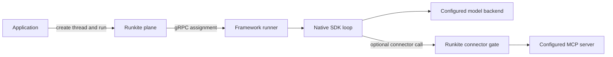

# 1. The control plane did not have to own every model loop

[Notebook home](README.md) · Next: [recovery and original identity](02-recovery-and-original-identity.md)

This chapter reconstructs the architectural progression visible in the
changelog, the historical governance proposal and the v0.10.0 implementation.
The alternatives below explain the current design; they are not a claim that
every alternative appeared in an original planning meeting.

## Start with a useful simplification

The original managed path gives a client a consistent way to start work. The
client creates a thread and a run over HTTP. Runkite authenticates that request,
applies admission controls, records the operation and dispatches an assignment.
A separate runner imports the framework and executes the agent. Events return
through the plane.

This division answers a practical question: how can applications operate agents
implemented in different frameworks without also becoming experts in each
framework's deployment and recovery behavior?

The answer is to standardize the operational boundary. Agent Protocol provides
the client-facing API shape; Runner Protocol carries assignments and lifecycle
messages to workers. Neither protocol makes the Go binary an implementation of
every SDK's model loop. The original LangGraph client path still matters:
an ordinary LangGraph SDK client can create and stream managed runs from
Runkite while LangGraph executes in its own runner process.

The [client guide](../../client-sdk.md#agent-protocol-clients-come-first) and
[Runner Protocol](../../../runner-protocol/PROTOCOL.md) are the current contracts.
The [historical walkthrough](../architecture-deep-dive.md) explains the initial
three-process model in much more detail.

## The application shape that challenges the simplification

Now consider a Next or Nuxt application using Vercel AI SDK. Its server route
already owns a model loop, tools, authentication and a response stream for the
browser. Putting backend and frontend code in one repository has not removed
the backend. It has placed the SDK's execution next to the application's own
request lifecycle.

An instruction to put every conversation through Agent Protocol now has two
possible meanings. The application could move execution into a Runkite runner.
Or it could keep executing locally while merely reporting events to Runkite.
Those arrangements provide different authority, even if both can display a
row called a run.

The [historical embedded-governance proposal](../embedded-governance-next-release.md)
records the concrete gap: an application that kept its loop could not use the
existing policy engine without adopting the managed assignment lifecycle.
The API shipped in v0.5.3. The later managed AI SDK path shipped in v0.5.8.
These were two answers to two callers, rather than competing implementations
of one universal adapter.

## First answer: ask for a decision at the tool boundary

An application can call `POST /governance/decide` immediately before a tool.
Runkite returns allow, deny or pending. If the decision is pending, the
application saves its proposal and later checks the approval action. The
application authenticates and executes its own continuation.

Read [handleGovernanceDecide](../../../internal/api/governance_decide.go) before
describing the guarantee. It derives the tenant from the authenticated request,
binds arguments and invokes the existing policy engine at `StageToolCall`.
It creates no managed thread or run and dispatches no assignment.

This placement explains an otherwise surprising limit. Managed kill switches
and budget admission live in
[admissionGate.Decide](../../../internal/api/admission.go), registered through
`RegisterAdmissionGate`. A decision-only tool request does not traverse that
run-creation pipeline. Naming its correlation field `run_id` cannot make that
pipeline happen.

Consequently, Admin can show a submitted decision or approval without having
the application's conversation. An allow proves that the supplied operation
was allowed under that decision contract. It does not prove that the tool ran,
that the application reported every tool, or that Runkite can stop its process.

The TypeScript
[createGovernedExecute](../../../typescript/runkite-governance/src/index.ts)
wrapper makes this boundary usable without silently expanding it. It captures
the executor configuration, snapshots and freezes policy input before its first
await, makes one decision call, then invokes the selected callback. It does not
poll, retry the tool or persist application continuation. Framework execution
options remain outside policy arguments; values that affect authorization must
therefore be represented in the submitted input.

That snapshot matters. If the application authorized one argument object and
executed a mutated object after the network await, the policy decision could
be correct while the action was wrong. A small helper can close that local
mutation window. It cannot guarantee what arbitrary executor code does after
it has been called, including a side effect before returning an unsupported
async iterable. Chat streaming and streaming tool return values are separate
capabilities.

## Second answer: put execution in a managed runner

For a caller that wants Runkite Threads/Runs, assignment, recovery, usage and
cooperative cancellation, move the agent's model loop into a runner. The
application starts a managed run instead of directly calling the model SDK.
The runner still uses the SDK's public APIs.

The model call goes from the runner to its configured backend. Runkite does
not become a mandatory model proxy. Ordinary local tools do not acquire
connector policy merely because the enclosing run is managed. Cooperating
runner `allowed_tools` checks and the connector gate are distinct controls.

The TypeScript worker's
[ExecutionAdapter](../../../typescript/runkite-runner/src/execution.ts)
separates framework execution from dispatch and completion delivery. Its
`load`, `execute` and `close` methods are deliberately small. Python's
[FrameworkAdapter](../../../python/runkite_runner/generic_worker.py) provides
the corresponding generic-worker seam. Some older adapters use the generic
opaque checkpoint hooks; the newer managed Python SDK adapters own their
native state commits and expose an empty `checkpoint_framework` to avoid a
second generic checkpoint layer.

The small interface is useful because it does not pretend that all frameworks
have identical state. [AiSdkAdapter](../../../typescript/runkite-runner/src/aiSdkAdapter.ts)
constructs a native `ToolLoopAgent`, uses native message history and converts
native streaming output. The managed Microsoft, OpenAI Agents, Pydantic AI and
Google ADK adapters retain their own native history representations. Their
initial supported subsets differ. An abstract `execute` method cannot make
native approvals, handoffs or arbitrary multimodal output work automatically.

The cost of this choice is explicit per-framework compatibility work. The
benefit is that SDK logic stays with the SDK and the lifecycle remains shared.
Importing every framework into the Go binary would couple its release, runtime
and dependency surface to every adapter without removing that compatibility
work. Forcing every framework through LangGraph would instead change the
framework semantics the caller wanted to keep.

## A completed conversation must survive the response stream

A provider returning an answer is only one milestone. A multi-turn agent also
needs durable native history. The generic worker's
[_execute_with_opaque_checkpoint](../../../python/runkite_runner/generic_worker.py)
buffers terminal events until the required save succeeds. A load failure must
not turn a continuing conversation into a fresh one. A save failure must not
be reported as successful durable completion.

The managed AI SDK adapter similarly saves native history and its completed
turn receipt before exposing successful completion. The receipt identifies
the run, original record and input; a matching committed receipt can be replayed
after reclaim without another model/tool cycle. The state write uses the
[AiSdkState](../../../typescript/runkite-runner/src/aiSdkState.ts) conditional
HTTP boundary. This is where SDK integration becomes a distributed-systems
problem rather than a translation of function names.

There is still a crash window between an external effect and the checkpoint
commit. A receipt proves what was durably recorded, not what a remote service
did during an unrecorded interval. Tool-specific idempotency and reconciliation
remain necessary. [Chapter 2](02-recovery-and-original-identity.md) follows that
window through queue acknowledgement and finalization.

## The browser is a presentation owner, not the worker's checkpoint

Moving the loop does not require moving the entire product UI into Runkite.
The application still owns user sessions, chat access, its saved turn-to-run
mapping and browser presentation history. The runner owns the native history
needed for another model turn. Replaying the browser's full message list as
authoritative worker history would let the UI overwrite that conversation.

The checkout's [managed bridge](../../../examples/managed_ai_sdk/bridge.ts)
turns these responsibilities into an application contract:

- Persist the server-owned run ID before dispatch when using detach behavior.
- Bind the first verified assistant identity through `onMessageStart` before
  displaying it. Supply `expectedMessageId` when attaching later.
- Use `attachManagedChatResponse` to observe existing work. Attachment does
  not dispatch another run.
- Distinguish `disconnectPolicy: cancel` from `disconnectPolicy: detach`.
  `cancelManagedChatRun` is a separate explicit Stop operation.
- Confirm the durable run result through `/wait` before presenting successful
  UI completion. Refuse mixed attempts rather than assembling plausible text
  from different executions.

The last point can disappoint a user who saw some tokens and expected a
seamless reconnect. It preserves a more important property: the application
does not silently replace one attempted answer with another. Recovery is a
validated operation, not concatenation of whatever events are available.

This bridge remains a checkout application helper, not a separately published
chat SDK. The two runner packages and two governance packages have different
jobs; publishing one does not install every example.

## The decision rule worth remembering

Choose a boundary by asking where the caller can wait before an effect and
who owns execution. If it can block at a local tool, a decision helper fits.
If Runkite must admit and dispatch the run, an actual managed runner fits.
If a component only emits traces afterward, those traces provide observation,
not pre-execution enforcement.

An external-run registry for independently executing applications could be a
future product, but reported lifecycle events would not by themselves grant
the same authority as managed assignment. A concrete caller, an honest
cooperative-cancellation contract and a real unmet need should justify that
subsystem. A desire to count every SDK logo does not establish those requirements.

## Test the explanation against the repository

In [governance_decide_test.go](../../../internal/api/governance_decide_test.go),
read `TestGovernanceDecide_AllowDenyAndPending` and
`TestGovernanceDecide_PermissionAndAgentRateLimit`. In
[aiSdkAdapter.test.ts](../../../typescript/runkite-runner/src/aiSdkAdapter.test.ts),
read the cases for persisting native history before UI finish, replaying a
committed result, refusing a missing original record proof and rejecting
client-supplied assistant history. In
[bridge.test.ts](../../../examples/managed_ai_sdk/bridge.test.ts), read the
attach-without-dispatch, failed durable confirmation and changed-attempt cases.
These are useful evidence pointers, not a statement that every SDK feature or
production deployment has been qualified.

For self-study, answer these aloud and then follow the named code:

1. Why does a Next application still have a backend, and what exactly changes
   when its loop moves to a runner? Trace the two routes above.
2. Why can a tool decision appear in Admin while Threads/Runs stay empty?
   Compare `handleGovernanceDecide` with `admissionGate.Decide`.
3. Why are UI message history, native history and a completed-turn receipt
   separate objects? Inspect `AiSdkAdapter.executeBound` and the bridge tests.
4. What does a browser disconnect mean? Explain cancel, detach and explicit
   Stop without promising rollback of an external effect.
5. What would justify adding another managed SDK adapter? Name the caller and
   native execution/state boundary, then state which native features remain
   unsupported instead of calling the interface universal.
