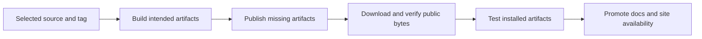

# 5. A passing implementation is only one part of a release

[Notebook home](README.md) · Previous: [integrations and operator truth](04-integrations-discovery-and-operator-truth.md)

This chapter uses recorded failures to explain the qualification and release
design as of v0.10.0. It is an engineering account, not a current deployment
checklist. Follow [Releasing](../../releasing.md) and the
[operator runbook](../../ops-runbook.md) when performing those operations.

## Begin with the claim, then choose the test

Suppose a worker test passes with a mocked model and mocked network. That can
show how the worker responds to the supplied messages and errors. It cannot
show that the published package contains the same code, that built-in Node
fetch accepts its TLS dispatcher, or that a second plane preserves authority
after another process dies.

Those are different claims with different observable boundaries. One useful
way to read Runkite's later development is as a sequence of discoveries that
the previous test boundary was smaller than the claim being made.

The consequence is not to replace unit tests with one enormous production
simulation. Unit tests provide fast, precise counterexamples. Installed-artifact
tests catch packaging and runtime boundaries. Real-plane fixtures exercise the
protocol and persistence together. Multi-process fault tests cover a bounded
failure topology. Each adds evidence without proving everything above it.

This distinction also explains the backend support tiers in
[Architecture](../../architecture.md#backend-support-tiers). Postgres plus Redis
is the Supported HA composition. Merely implementing a storage or queue
interface does not establish identical governance, transaction or failover
semantics on every backend. Mongo's SQL-only feature limits and Kafka's
explicit weaker mode must remain visible even when other tests pass.

## A concrete failure: the TLS helper was correct at the wrong boundary

The [Node fetch compatibility record](../node-fetch-tls-compatibility.md)
documents a packaged TypeScript worker that could reach gRPC but failed HTTP
preflight under Node 22.19.0. The installed Undici dispatcher and the built-in
fetch expected different callback contracts. A mocked fetch did not exercise
that interface.

The worker's refusal was operationally expensive: the assignment could not
execute and became recoverable. Refusing was still preferable to running after
an unconfirmed ownership check. A transport problem must not become an
authorization bypass.

The repair in [tls.ts](../../../typescript/runkite-runner/src/tls.ts) uses
Undici's public `Dispatcher1Wrapper` from `httpDispatcher`. Runkite did not
implement another HTTP stack or disable certificate validation. Its
`HTTPSOnlyAgent` still refuses plaintext use of client credentials. The
dependency owns the translation between its supported dispatcher contracts.

This is a useful example of where integration effort belongs. The problem was
not solved by another abstract interface inside Runkite. It was solved at the
dependency's real compatibility boundary and then tested with the installed
package on both advertised Node test versions. Read
[workloadIdentity.e2e.test.ts](../../../typescript/runkite-runner/src/workloadIdentity.e2e.test.ts)
alongside the small TLS tests, rather than treating either as a replacement
for the other.

## Negative controls make a security test falsifiable

A security fixture that accepts the expected configuration can be broken in
the same way as the implementation. It needs cases that should fail. If an
incorrect peer, missing assignment identity or widened policy also passes,
the fixture has not demonstrated the intended distinction.

The external-runtime work adds another complication. A sandbox appearing
absent after a final force-cleanup does not show that ordinary worker
cancellation removed it. The observation must happen before the final sweep.
Similarly, an inner script returning success does not establish that its
supervisor observed the expected identity, cancellation and cleanup evidence.

The shared acceptance design in
[isolated_ha_evidence.py](../../../scripts/isolated_ha_evidence.py) and the
[constrained execution record](../constrained-execution.md) make those questions
explicit. Deliberate child environments from
[isolated_fixture_environment.py](../../../scripts/isolated_fixture_environment.py)
avoid accidentally inheriting a local credential or alternate backend.
Structured receipts distinguish an executed control from a missing, skipped or
merely requested one.

The separate [effective-policy checker](../../../scripts/isolated_policy_qualification.py)
and [OpenShell policy record](../openshell-effective-policy.md) address policy
snapshots. Even then, observed current/loaded policy plus a checker's containment result
does not atomically bind the next exec, prove continuous kernel enforcement or
discover every hidden provider credential. Repeating a bounded failover fixture
does not turn it into a long-running production soak. Independent assessment
remains a separate activity. The engineering decision is to make the evidence
more specific, not to inflate the name of the guarantee.

## Publication is a distributed workflow too

A release has several independently failing destinations: GitHub archives,
OpenAPI assets, npm packages, PyPI files and multi-architecture image indexes.
A Git tag identifies intended source. It does not prove that all those systems
accepted and now serve the intended artifacts.

The arrows are reasoning and evidence requirements, not one atomic transaction.
Go publication can succeed while one registry fails. A registry can accept an
upload before its normal public endpoint serves it. A retry may encounter an
existing immutable version rather than an empty destination.

The first defense is identity. `check_release_versions` in
[check-release-version.py](../../../scripts/check-release-version.py) compares
the coordinated Go release, Python/npm metadata, linked package snapshots and
Helm versions. The tag must agree too. Protocol negotiation capabilities,
framework dependency pins and schema migrations have their own meanings;
incrementing every number to the application version would erase those meanings.

[GoReleaser](../../../.goreleaser.yaml) supplies binary version, commit and
build-time metadata and includes legal files and the embedded Admin assets.
The distinction between source and payload continues after compilation:
checking out the right Git commit does not show that an installed wheel, npm
tarball or architecture-specific image contains that commit's implementation.

## Why recovery keeps the original identity

[release_artifacts.py](../../../scripts/release_artifacts.py) builds intended
packages, records integrity and member manifests, and checks public registry
contents. It never publishes by itself. `archive_members` includes each regular
file's bytes and mode; a matching package name/version alone is insufficient.
For PyPI recovery, archive timestamps may differ while member bytes remain
identical, so container-byte identity and normalized member identity are
different checks. The v0.10.0 independent public verification additionally
compared the actual files to the original retained bytes.

The checker treats only an explicit metadata 404 as absence. Authentication
failures, uncertain network failures, malformed responses and content
mismatches are errors, not permission to upload again. Public reads are bounded
and restricted; registry-controlled download metadata cannot send the checker
to an arbitrary host.

Consider the dangerous simpler recovery rule: if any release job is red,
rebuild everything and publish again. Some destinations may already contain
the first attempt. Rebuilding can change archive bytes, dependencies or
metadata, while moving the tag destroys the link between the original attempt
and its evidence. Neither action explains what users already downloaded.

`prepare` in
[prepare_release_recovery.py](../../../scripts/prepare_release_recovery.py)
instead resolves the immutable tag, validates the original tag-push workflow
and source, requires successful original version/Go publication jobs and checks
the matching published GitHub Release. Recovery separates runtime source from
the controller performing repair. The documented PyPI recovery verifies the
original retained files without upload authority. npm recovery uses the
validated original source and verifies existing content or publishes a genuinely
missing package under its defined checks. Go and container publication stay
outside that package-only path.

The tests are worth reading as a specification. In
[test_release_artifacts.py](../../../scripts/test_release_artifacts.py), compare
`test_matching_metadata_does_not_hide_different_tarball`,
`test_existing_download_404_and_network_failure_are_not_absence` and
`test_changed_local_artifact_is_never_used_for_recovery`. In
[test_prepare_release_recovery.py](../../../scripts/test_prepare_release_recovery.py),
`test_rejects_wrong_run_provenance` and
`test_requires_both_successful_original_jobs` explain which evidence a caller
cannot substitute.

## An upload acknowledgement is not public availability

Publishing authority is specific to the path that actually succeeded.

The [v0.10.0 publication record](../release-verification-v0100.md) preserves an
instructive partial result. npm governance uploaded successfully through Trusted
Publishing, but its original short public-visibility check expired. npm runner's
automated authentication failed; the maintainer published the unchanged retained
tarball through the personal account and completed npm verification directly.
The PyPI helper used OIDC and the PyPI runner used its project token.

Those are four different observed authentication paths. A configured Trusted
Publisher is not proof of a successful live token exchange. A later
matching-existing check is not a new authenticated upload. A GitHub Actions
`continue-on-error` step can have a successful conclusion after its actual
attempt failed, so the workflow records step outcomes separately.

The post-tag controller waits up to 300 seconds for explicit missing npm
artifacts to become visible. It still refuses uncertain or mismatching results.
Increasing a bounded read wait addresses visibility lag; it does not repair
runner publishing authority or justify moving an immutable version.

## A release record must state the shape of its proof

For v0.10.0, the record distinguishes four downloaded binary executions,
registry-file verification and installed contracts, six image runtime checks
and remote vulnerability scans. Local amd64 execution used emulation, which
is not native hosted Linux qualification. Matching embedded Admin assets is
not a browser test on every architecture. The source/hosted HA evidence has
its own commit identities and scope.

The accepted Admin dependency exception is another example of precision. The
v0.10.0 record names the advisory, exact manifest/lock/report binding and
November 25, 2026, 00:00 UTC expiry. This historical description grants no future
exception and does not mean the vulnerability was fixed. Likewise, the image
scan policy's HIGH/CRITICAL and `--ignore-unfixed` scope does not establish that
an image contains no vulnerabilities.

An operator also needs to know how to deploy the change. Original-record
accounting and assignment identity require matching planes, workers and custom
integrations, migrations 23/24, stopped writers, backups and reconciliation of
ambiguous legacy evidence. A convenient mixed-version fallback would reintroduce
the missing-proof behavior the new protocol refuses. The upgrade sequence and
rollback limits are therefore part of the design, not release administration
added after the interesting engineering.

## Documentation and the public UI are operational outputs

A feature can be implemented and still be unavailable in a user's existing
package. Conversely, a published feature can remain effectively undiscoverable
behind an obsolete unreleased label. That is why availability promotion follows
actual artifact verification, while historical tag records remain intact.

The static product website and the embedded Admin are also different artifacts.
[site-hosting.md](../../site-hosting.md) explains that GitHub Pages serves
documentation and recorded illustrations; it cannot execute the Go plane,
database or runners. Keeping an offline public Admin entry point preserves its
URL without pretending that an animation is live backend traffic. This mirrors
the wider design principle: presentation must describe observed authority and
state accurately.

## Practice the causal explanation

1. Why did the Node 22 failure survive a mocked fetch test? Point to the real
   dispatcher boundary and explain why disabling TLS checks would be a different,
   unacceptable change.
2. A publish command succeeds but a registry GET returns 404. What do you know,
   what remains uncertain and which operation should be retried? Read
   `public_get`, `check` and their negative tests.
3. Why can package recovery succeed while the original Release remains red?
   Explain original upload outcomes, immutable source and matching-existing
   verification as separate facts.
4. What does an amd64 image smoke on an arm64 laptop establish? Name the extra
   evidence needed for a native-runtime or HA claim.
5. Why does a coordinated upgrade belong in a system-design explanation?
   Describe the invariant an older writer would violate, then explain why
   preserving ambiguous legacy evidence is safer than guessing its owner.
