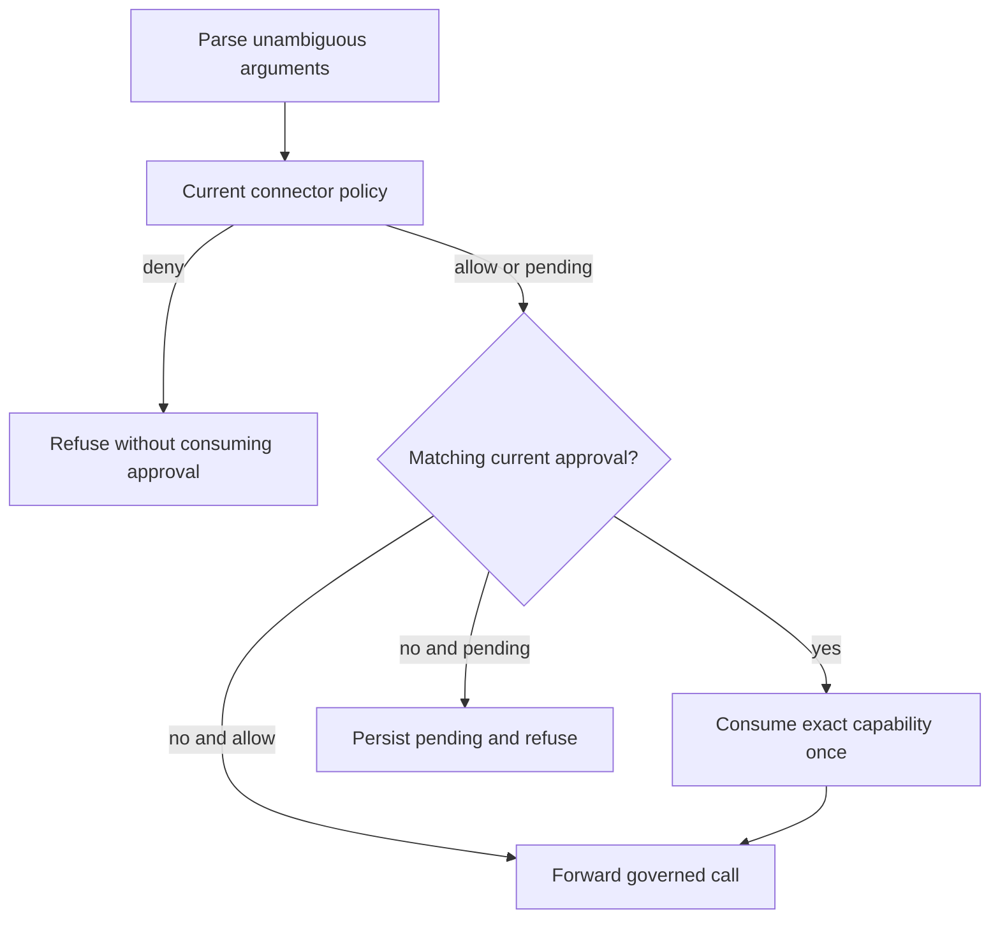

# Runtime hardening: authority, recovery and operator feedback

This is the current design record for the hardening pass based on `ad0b68c`.
It describes source changes, their reasons and the regression boundaries.
The changes are unreleased until a tagged artifact contains them. Source presence
and package version metadata do not establish published availability.

Runkite already had separate runners, run-bound connectors, durable completion,
CAS opaque checkpoints, tenant-scoped state and managed SDK receipts. This pass
extends those existing mechanisms. It introduces no model gateway, policy engine,
vault or embedded agent runtime. MySQL schema version 17 corrects identity
comparison in the existing Compatible backend.

Read [Architecture](../architecture.md), [Trust and governance](../trust-governance.md)
and [Limitations](../limitations.md) for the product contract. Older engineering
chapters remain historical; this record explains the corrected paths.

## The invariants

A runner mutation belongs to one run and one generation. An approval belongs to
one tenant, agent, run, generation, connector, tool and argument value. A remote
HTTP decision belongs to the configured origin. A successful completion exposes
consistent durable state. A UI confirmation must follow a confirmed server action.

Those statements are stronger than a successful happy-path demo. Each must also
hold after a delayed request, a partial response, a changed policy or a failed
backend operation.

## MySQL identity comparison must preserve tenant boundaries

The MySQL driver inherited its database's default collation. MySQL 8 commonly
uses `utf8mb4_0900_ai_ci`, which equates case and accent variants. A query for
one tenant could therefore read a differently spelled tenant, and resource
upserts could replace an existing identity instead of inserting a distinct one.
Authentication using exact strings does not repair a database equality mismatch.
Live regressions reproduce this on stock MySQL 8.4, including canonically
equivalent but byte-distinct Unicode spellings.

State migration **17** changes an explicit list of identity and security-scope
columns to `utf8mb4_0900_bin`, a binary **NO PAD** collation. Trailing spaces must
also remain distinct. It covers tenant/resource IDs, store keys/namespaces,
policy and pending bindings, checkpoint identity and usage attribution. Human
display names, descriptions, search text and table defaults retain their existing
comparison rules. This corrects the backend contract without adding a second
identifier normalization scheme to every query.

MySQL DDL autocommits. The migration cannot promise a transaction spanning all
ALTER statements. The existing schema lock serializes migrators, not application
writers. Take a verified backup, stop every writer and old replica, allow an
ALTER maintenance window and explicitly run `runkite db upgrade` before service
resumes. Startup also upgrades; do not use a rolling mixed-version deployment
for this migration. The server must provide the target MySQL 8 collation.

Before any DDL, the migration validates the stock foreign-key shapes/actions,
column definitions and exact existing references. Child runs and checkpoints
must have the same exact tenant as their parent thread. Legacy aliased references
or inconsistent ownership block the upgrade for explicit investigation and
repair. Custom incompatible constraints also fail preflight. Never bypass this
by disabling foreign-key checks or deleting records merely to make upgrade pass.

After preflight it removes the owned foreign keys, changes only columns still
needing conversion, and restores the canonical cascading constraints. A failed
DDL step leaves version 17 unstamped. With all writers still stopped, fix the
underlying cause and rerun the same upgrade; the steps inspect current metadata
and resume. Do not resume service while constraints are absent or the migration
is incomplete. Version 17 downgrade refuses to merge identities that have become
distinct. Restore a verified backup for a planned rollback.

The migration preserves existing data and supported column defaults. It cannot
reconstruct a tenant or resource already overwritten under the old collation.
Postgres, SQLite and Mongo schemas do not change. MySQL remains Compatible;
the Supported HA pair remains Postgres and Redis.

Sources: [migration](../../internal/state/mysql/identity_collation.go),
[registration](../../internal/state/mysql/mysql.go),
[identity regression](../../internal/state/mysql/identity_collation_test.go),
[migration regressions](../../internal/state/mysql/identity_collation_migration_test.go).
Tests cover exact tenant/resource matching, definition/data retention, cascade
behavior, interrupted-DDL resume and rejection before DDL for aliased references
or custom constraint conflicts.

## Returning a job must fence the attempt too

`Renew` and `Ack` already checked generations. `Nack` only accepted a run ID.
A delayed `GetJob` error from generation 1 could therefore return generation 2 to
the ready queue after reclaim had installed it. The old worker did not need to
publish a result to disturb its replacement.

`transport.JobQueue.Nack` now receives the generation. The bridge forwards the
exact assignment generation on every return path. In-process, Redis, NATS and
Kafka implementations reject stale generations, including zero on a versioned
assignment. Custom Go queue implementations must update this internal interface.
There is no Runner Protocol wire change.

Redis returns the original assignment bytes to the ready list and removes the
lease in one fenced Lua operation. The list write occurs before lease deletion:
a wrong-type ready key must leave the job recoverable. In-process queues copy
assignment generation state, so reclaim cannot change the generation already
handed to a caller by mutating an aliased pointer.

Reclaim leader ownership also uses a unique token per loop. A hostname is not a
process identity: two control planes on the same host previously shared the
renewal identity. The existing lease lifetime and Kafka coordination limitations
still apply; this is not a new Kafka HA guarantee.

Sources: [queue contract](../../internal/transport/types.go),
[bridge](../../internal/bridge/server.go),
[Redis](../../internal/transport/redis/redis.go),
[in-process queue](../../internal/transport/inprocess/inprocess.go),
[reclaim leader](../../cmd/reclaim.go).
Tests include shared queue conformance, delayed bridge returns, Redis failed
ready writes, zero-generation fencing and same-host leader ownership.

## A checkpoint is a state snapshot, not the last result patch

Completion already merged new values into the thread row. It saved only the
new values in the completion checkpoint. After results `{"a":1}` then `{"b":2}`,
the thread retained both keys while `/state` and history could lose `a`.

The completion checkpoint now contains the merged thread state. `run.output`
continues to contain that run's result, rather than silently gaining older fields.
The existing completion transaction remains the commit boundary. Native opaque
SDK history and committed-turn receipts are separate and retain their existing
semantics. This does not manufacture unfinished agent history on cancellation.
Historical checkpoints are not rewritten.

Sources: [SQL completion](../../internal/state/sqlcompletion/completion.go),
[Mongo completion](../../internal/state/mongo/completion.go),
[API regression](../../internal/api/completion_snapshot_test.go).
Shared store regressions compare the thread, each checkpoint and per-run output.

## Authorization must compare the submitted JSON value

The earlier application-number fix preserved run output. Policy arguments still
passed through `float64`. For example, `9007199254740992` and `9007199254740993`
could share an approval digest, and a strict numeric threshold could miss the
larger value. A database storing the original result does not repair an earlier
authorization decision.

Policy arguments and configured predicate values now retain JSON numbers.
`CompareNumbers` orders finite decimal values using normalized coefficients and
exponents. It never expands a huge exponent or converts through binary floating
point. Production code does not use arbitrary-precision rational arithmetic;
independent tests use `math/big.Rat` as an oracle.

Authorization JSON also rejects duplicate members, invalid UTF-8 and unpaired
UTF-16 escapes. Those inputs can have different meanings in different parsers.
MCP `arguments`, when present, must be an object. Governance keeps its existing
any-JSON contract and its documented omitted/null-to-empty-object shorthand.
A string containing JSON stays a string; it is not reparsed as an object.
Application key case is preserved.

Argument digests use sorted-key JSON with normalized exact numbers and a v2
namespace. Numeric spellings such as `1000` and `1e3` describe one value; a string
and an object remain different. These are internal canonicalization rules, not a
claim to implement RFC 8785.

### Approval upgrade behavior

Old hashes were produced by the lossy parser. Reusing them could authorize an
operation different from the one reviewed. New requests therefore cannot consume
old hashes. SQL consumption also no longer treats an empty stored digest as a
wildcard, and an empty presented digest cannot consume an approval.

New action identifiers carry an internal binding-version marker. Clients must
continue treating identifiers as opaque. Admin refuses to approve legacy pending
rows. Polling a legacy pending/approved app action returns `rejected` with
`approval_binding_legacy`. Existing rows remain audit records. The caller must
resubmit the original operation and obtain a fresh review; there is no automatic
execution, approval migration or reconstruction of old argument precision.

A prior approval can bypass another `pending` result, but cannot override a
current explicit deny. The proxy evaluates current policy before consuming the
capability. Revoking a grant or introducing a deny after approval now prevents
forwarding and leaves the unused approval unconsumed. Explicit break-glass
behavior remains governed by its existing audited policy path.

Sources: [JSON helpers](../../internal/jsonvalue),
[argument binding](../../internal/policy/args.go),
[predicates](../../internal/policy/predicates.go),
[configuration](../../internal/config/loader.go),
[proxy](../../internal/api/server.go),
[pending actions](../../internal/api/policy.go),
[API regressions](../../internal/api/hardening_policy_test.go).
Pending display reads use the shared lossless decoder. Native backend numeric
limits and JavaScript browser limits still apply to previews; use strings for
large identifiers that must display exactly in ordinary browser clients.

## An uncertain tool call must not become an automatic retry

Connector helpers previously renewed a capability after any HTTP 401. The proxy
also forwarded upstream 401 unchanged. A tool can write successfully and then
return 401; that response does not establish that replay is safe.

Only the plane's pre-dispatch `connector_session_invalid` response permits one
automatic renewal. Upstream 401 becomes HTTP 502 with
`connector_upstream_unauthorized`. Timeouts, unmarked 401, malformed errors and
transport failures do not trigger tool replay. Caller-supplied capabilities keep
their no-renewal behavior.

One deadline covers session minting, proxying, response bodies and optional
renewal. Defaults are 30 seconds for a session and 60 seconds for a proxy
operation. The helpers snapshot arguments and run binding before awaiting network
work. Python task cancellation closes its client. TypeScript accepts the managed
factory's `signal`; the tool author must pass it. Cancellation does not undo an
upstream effect already committed.

Heartbeat RPCs have a one-second default bound. A stuck RPC cannot block every
later renewal. Stopping a TypeScript heartbeat cancels its active call and ignores
late superseded replies. The normal two-second cadence and six-second reclaim
age remain; partitions and overloaded processes can still cause reclaim.

Sources: [Python connectors](../../python/runkite_runner/connectors.py),
[TypeScript connectors](../../typescript/runkite-runner/src/connectors.ts),
[Python heartbeat](../../python/runkite_runner/heartbeat.py),
[TypeScript heartbeat](../../typescript/runkite-runner/src/heartbeat.ts).

## A redirect cannot select a new authority

Runner tokens use custom headers, and Vault uses `X-Vault-Token`. A default HTTP
redirect can forward those headers or replay a request body to a different
endpoint. A redirected governance reply must not become the plane's allow.

Runkite-owned runner/governance HTTP clients refuse redirects. Plane connector,
Vault, webhook, manual redelivery and vector HTTP clients also refuse them.
Negotiated upstream MCP already had this behavior. Configure the final endpoint
URL directly; an interactive login redirect is not an API authentication flow.
Pinecone's explicit data-host discovery remains its existing protocol step.

Webhook auth, policy and preflight parse complete bounded responses. A valid
allow followed by enough whitespace to hit a truncating reader must not hide
additional bytes or a read error. The auth response limit is 1 MiB; policy and
preflight use the same bound. Auth requires a successful HTTP status and honors
the original request's cancellation. Policy effects must be `allow`, `deny` or
`pending`; an unknown effect follows the configured webhook failure behavior.
Explicit policy `fail_closed: false` remains an operator-selected fail-open
setting, including transport errors.

Vault paths are URL-decoded once before cleaning and prefix validation. Residual
escapes, backslashes, query syntax and fragments are rejected. The validated path
is assigned through `URL.Path`, so percent syntax cannot alter the requested
Vault location after the prefix check. No Vault runtime or second secret store
is added.

Sources: [auth webhook](../../internal/auth/webhook.go),
[policy webhook](../../internal/policy/webhook.go),
[preflight](../../internal/hooks/gate.go),
[async delivery](../../internal/hooks/webhook.go),
[Vault resolver](../../internal/connector/secretref.go),
[vector clients](../../internal/vectorstore).
Local two-origin tests assert that redirect targets receive no credentials,
operation bodies or fake-allow requests. No external provider is needed.

## Cache the authentication context actually sent to the provider

The auth webhook forwards all request headers. Its cache key previously included
only bearer/API keys, method and path. Two callers authenticated through different
cookies or custom identity headers could therefore share an identity.

The key is now a SHA-256 of the exact forwarded request payload. Header ordering
is canonical through JSON encoding. No new persistent credential log is created;
the existing bounded TTL cache remains. A unique forwarded request ID can reduce
cache hits, which is preferable to reusing a decision from a different context.
Cancelled requests do not populate shared cached denials.

Tests cover distinct cookie/custom-header identities, repeated identical context,
non-2xx fake allows, oversized/trailing responses, cancellation and redirects.

## Logout needs confirmed revocation

Redis session deletion previously logged errors and returned no result. The HTTP
handler returned 204 and cleared the cookie even when revocation had failed.
The Admin client also ignored failed DELETE responses and displayed logout.

`SessionStore.Delete` now returns an error. A failed revocation returns 503 with
`admin_session_revoke_failed`, without pretending to clear the session. Admin
retains local authentication/CSRF state and shows that logout was not confirmed.
The operator can retry when the backend recovers. A confirmed deletion expires
the cookie and invalidates the stored session. Custom session stores must update
their internal Go method signature.

Sources: [session contract](../../internal/auth/adminsession.go),
[Redis sessions](../../internal/auth/adminsession_redis.go),
[HTTP handler](../../internal/auth/adminsession_http.go),
[Admin auth](../../admin-ui/src/auth/AuthContext.tsx).

## Display feedback must not race or exhaust the browser

Admin polling is serialized. Navigation aborts old requests, and stale replies
cannot replace a newer route's record. The SSE reader supports LF, CRLF and CR,
preserves data whitespace, bounds unfinished frames and releases its reader.
Raw event panes show bounded previews with an explicit truncation label; the saved
output and API payload remain available separately.

Admin path components encode caller-supplied IDs. New exact `.` and `..` run/thread
IDs are rejected before persistence because browsers normalize these path
segments. Other custom IDs remain supported. This does not rename old records.
The managed chat bridge now bounds stalled browser request intake with its
existing `timeoutMs`, before creating a managed run. App authentication, message
storage, reconnect mapping and the distinction between detach and Stop remain
app responsibilities.

Sources: [Admin API client](../../admin-ui/src/api/client.ts),
[polling](../../admin-ui/src/api/useApi.ts),
[SSE reader](../../admin-ui/src/api/read-sse.ts),
[managed bridge](../../examples/managed_ai_sdk/bridge.ts).
The embedded Admin bundle must be rebuilt with its source; both are in this patch.

## Known dead-letter IDs should use indexed lookup

Manual redelivery previously searched only the latest 1,000 dead letters. A valid
older ID could return 404. All built-in stores now implement the optional
`state.WebhookDeadLetterLookup`, and Admin fetches the exact ID. Tenant scoping
and existing indexes are reused; no migration or new pagination API is needed.
Custom stores without the optional method retain the older bounded-list fallback.

Redelivery refuses redirects and reports success only on 2xx. It remains unsigned
because signing secrets are not stored in dead-letter records. Successful replay
retains the audit row and is not proof of external exactly-once execution.

## Validation and limits of this pass

Regression tests accompany every corrected path. The handoff manifest records
exact source hashes, passing commands, service profiles and artifact hashes.
It distinguishes optional skipped tests from independently executed integration
profiles. Build results, a local service run and a mocked model are different
kinds of evidence; none is presented as a cloud HA soak or vendor invoice.

No finite audit establishes that a product is free of all future bugs. These
changes do not promise exactly-once external writes, sandbox arbitrary tools,
publish the governance helpers, add native approval/resume to SDKs, turn
app-owned decisions into managed runs, repair historical rounded values, or remove
backend/JavaScript numeric limits. Supported HA remains Postgres plus Redis.
